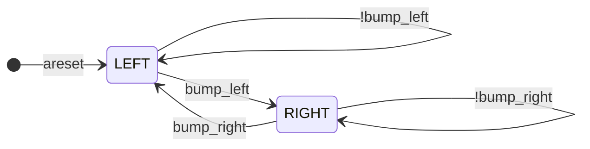

一生一芯的E1阶段要求掌握基本的Verilog语法，其中的重要测试以FSM（有限状态机）电路实现为主：


这里对Verilog->FSM的范式进行总结和提取，从而进一步的解释语法。

对于任意一个有限状态机，我们都可以按照三段式，对其进行分解：

+ Phase1（时序逻辑）：对状态寄存器采样，描述当前状态随时间沿更新
+ Phase2（组合逻辑）：状态转移逻辑，根据当前状态和转移条件计算下一状态
+ Phase3（输出逻辑）：根据状态组合需要输出的信号。

以一个典型的人物状态系统为例：


我们可以画出状态机模型：



其verilog实现如下：

```verilog
module top_module (
	input clk,
	input areset,
	input bump_left,
	input bump_right,
	output walk_left,
	output walk_right
);

	// 定义状态与状态寄存器
	parameter WL=0, WR=1;
	reg state;
	reg next;
    
	// 根据状态和状态转移规则的组合逻辑
    always@(*) begin
		case (state)
			WL: next = bump_left  ? WR : WL;
			WR: next = bump_right ? WL : WR;
		endcase
    end
    
 	// 用于状态寄存器迁移 根据时序信号转移
    always @(posedge clk, posedge areset) begin
		if (areset) state <= WL;
        else state <= next;
	end
		
	// 输出逻辑
	assign walk_left = (state==WL);
	assign walk_right = (state==WR);
endmodule
```

在此基础上我们可以引入更多的状态和迁移。只要我们能将有限状态机的转移图画出来，就可以将其化成我们的三段形式。

关于有限状态机的总结就到此为止了。